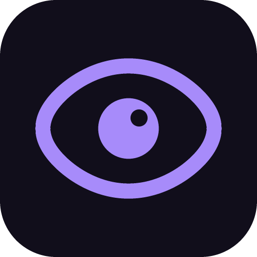
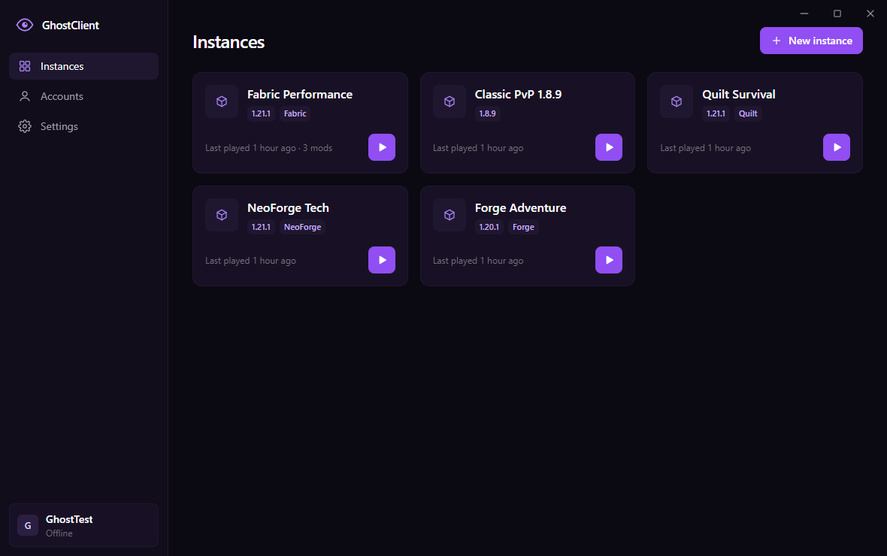
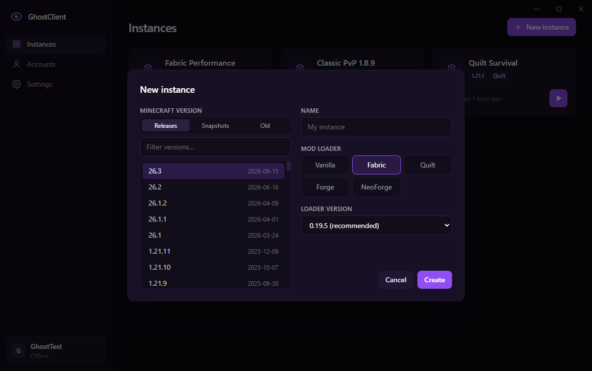
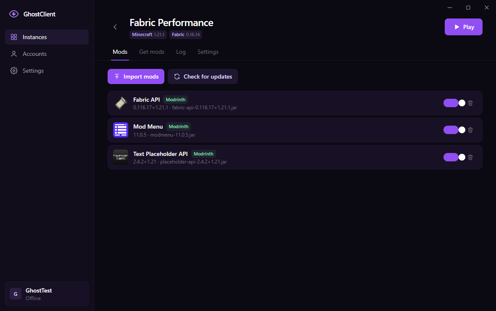
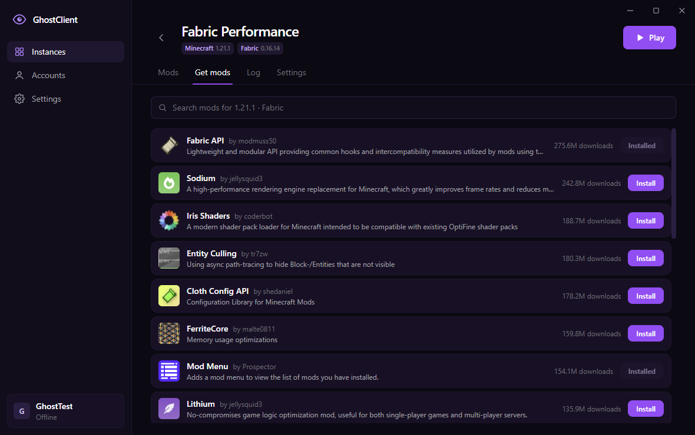

  

<h1 align="center">GhostClient</h1>

A Minecraft: Java Edition launcher for Windows.

---

## What it is

GhostClient is a desktop launcher for **Minecraft: Java Edition**. It lets players:

- create separate game instances for any Minecraft version (releases, snapshots, old versions)
- use the Vanilla, Fabric, Quilt, Forge or NeoForge mod loaders
- browse and install mods from Modrinth and CurseForge, with dependencies resolved automatically
- import their own mod `.jar` files
- sign in with their **Microsoft account** and launch the game they own

GhostClient downloads game files only from official sources: Mojang, the loader projects, Modrinth and CurseForge. It does not include or redistribute any Minecraft game files.

## Microsoft sign-in and privacy

- Sign-in uses the official Microsoft OAuth page (`login.microsoftonline.com`). GhostClient never sees or stores the user's password.
- The Microsoft, Xbox Live and Minecraft tokens are used only to authenticate the game with Mojang's services (`api.minecraftservices.com`).
- Tokens are stored only on the user's computer, encrypted with the operating system's secure storage. They are never sent to any server run by GhostClient. GhostClient has no servers and no analytics.
- Only players who own Minecraft: Java Edition can launch the game.

## Screenshots

| Create an instance | Installed mods |
| --- | --- |
|  |  |

## Status

In development. Windows builds come first.

---

*GhostClient is not affiliated with Mojang Studios or Microsoft. Minecraft is a trademark of Mojang Studios.*
